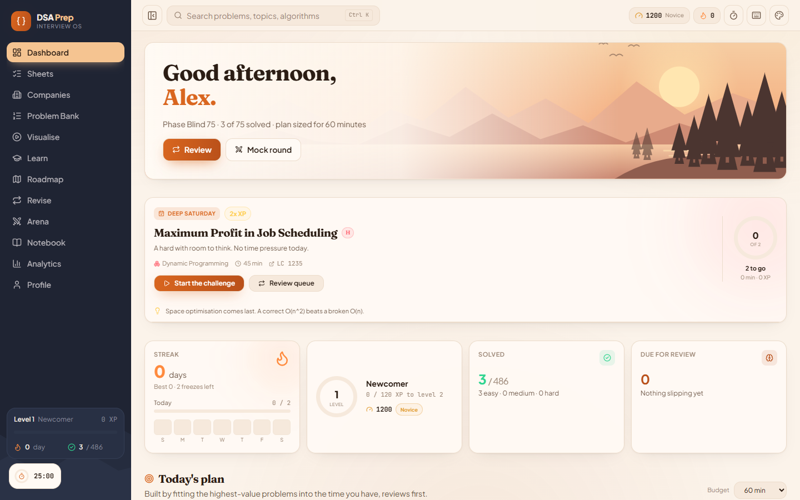
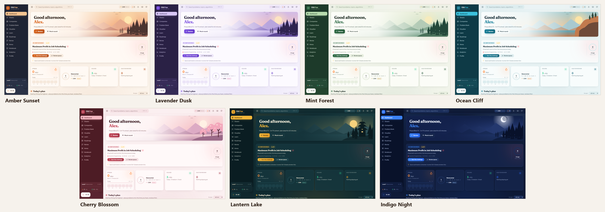
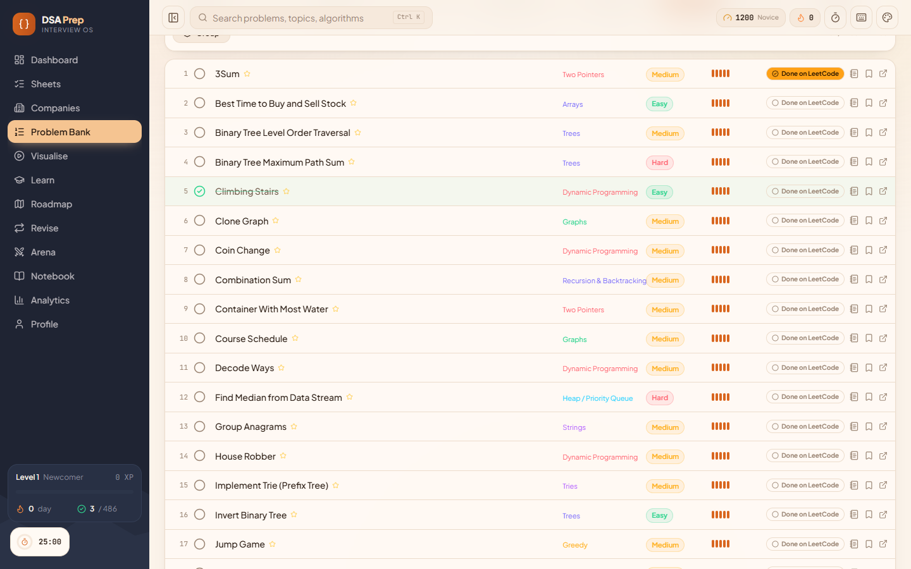
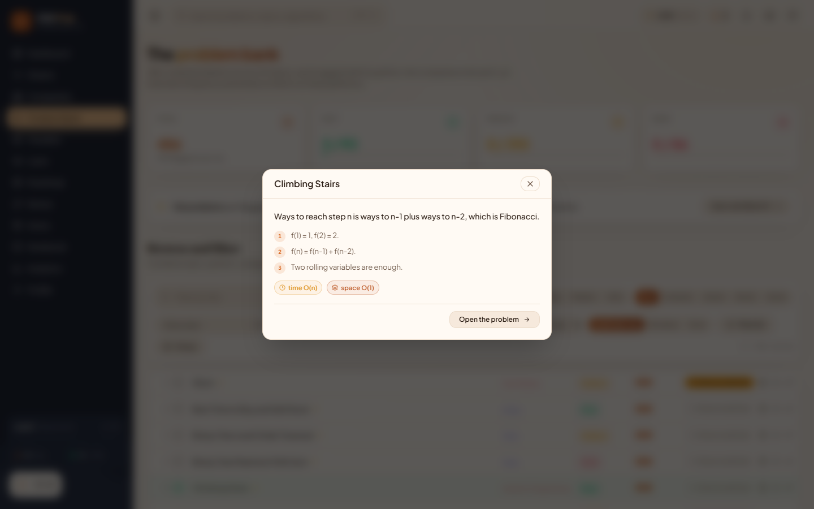
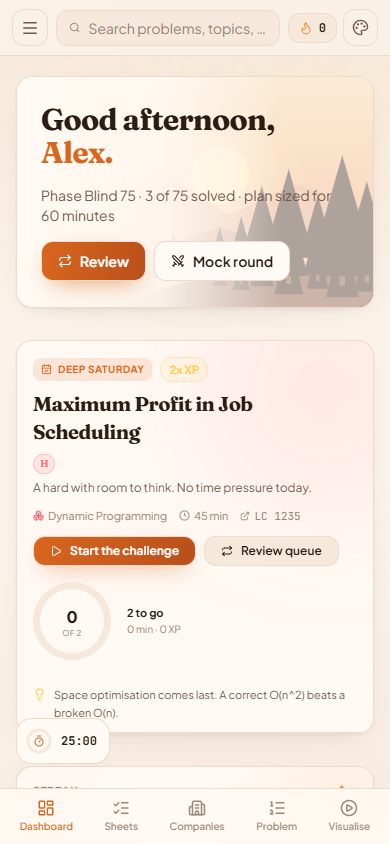

# DSA Prep — Interview OS

**An installable, offline DSA interview trainer.** 486 problems in nested sheets, 42 company lists, 46 animated
algorithm visualisers, a quick refresher for every problem, spaced repetition, and a planner that sizes each day to
the time you actually have.

No account, no backend, no ads. Everything runs in your browser and your progress never leaves your device.

### ▶ [Open DSA Prep](https://dsa-prep-theta.vercel.app) · [Install it](#install-it-in-a-minute) · [User guide (PDF)](docs/DSA-Prep-User-Guide.pdf)



---

## Install it in a minute

DSA Prep is a Progressive Web App: open the website once, install it, and from then on it opens from its own icon,
full screen, with or without internet.

**1. Open [dsa-prep-theta.vercel.app](https://dsa-prep-theta.vercel.app)**, then follow the steps for your device.

| Device | Browser | Steps |
|---|---|---|
| **Windows, Mac, Linux** | Chrome, Edge or Brave | Click the **install icon** at the right end of the address bar. Or open the browser menu → **Install DSA Prep** (Brave: **Save and share → Install page as app**). |
| **iPhone or iPad** | Safari | Tap **Share** (the square with an arrow) → **Add to Home Screen** → **Add**. |
| **Android** | Chrome | Open the **⋮** menu → **Install app** (or **Add to Home screen**). |

You can also press **Install the app** in **Profile → Your data** inside the app, which runs your browser's own
installer, or shows these steps if your browser has none.

**2. Open it from the new icon.** That's it. There is nothing to sign up for.

> **Where is my progress saved?** On your device, in the browser you installed from, for the exact address you
> installed from. The installed app and the website at the same address share it. A *different* address, a different
> browser, or a private window starts empty. To move progress between devices, use **Profile → Your data → Export**,
> then **Import** on the other device. **Profile → Your data** also shows which address your progress belongs to.

---

## What's new

- **Seven themes**, each a complete look with its own sidebar, page colours, accent and a drawn landscape on the
  dashboard: Amber Sunset, Lavender Dusk, Mint Forest, Ocean Cliff, Cherry Blossom, Lantern Lake and Indigo Night.
  Pick one from the palette button in the top bar or in Profile → Settings, or press `t` to cycle.
- **"Done on LeetCode" on every problem.** Each row has a toggle that starts unselected and turns LeetCode orange when
  you mark it. It's kept separate from the sheet tick, and those problems are swapped for similar ones you haven't done.
  You can also paste your whole solved list in Profile.
- **A quick refresher for all 486 problems**: the key idea, the steps, the usual mistake and the complexity, for when
  you've solved something before and need it back in a minute. It's on every problem page, and the note icon on any row
  opens it in a pop-up.
- **Easier installing**: PNG and iPhone icons, an "Add to Home Screen" hint on iPhone, a one-click install button, and
  persistent storage requested from the browser so your progress isn't evicted.



| Every row: status, LeetCode toggle, refresher | The quick refresher | On a phone |
|---|---|---|
|  |  |  |

---

## What is in it

| | |
|---|---|
| Problems | 486, each tagged with topic, patterns, companies, interview frequency, target time and where to find it on other platforms |
| Refreshers | 486, one per problem: key idea, steps, the usual mistake and complexity |
| Sheets | 5 strictly nested phases: Blind 75 → Top 150 → SDE 250 → DSA 450 → the Vault |
| Companies | 42 profiles with round structure, what their bar is, difficulty mix and a readiness score |
| Visualisers | 46 step-by-step animations with narration, pseudocode tracing and editable input |
| Topics | 24, ordered by prerequisite so nothing uses an idea you have not met |
| Patterns | 48, each with trigger phrases, a template and a hint ladder |
| Roadmap | the 24 topics as a 7-layer prerequisite graph, gated by mastery |
| Themes | 7 complete looks, five light and two dark, each with its own dashboard landscape |
| Guide | `docs/DSA-Prep-User-Guide.pdf`, five pages covering everything below |

### Nested phases

The sheets are supersets of each other, so a problem solved in Blind 75 is already solved in DSA 450 and
shows a "done in 75" badge there. Moving up a phase never asks you to redo anything.

```
Vault (486)
└── DSA 450 (450)
    └── SDE 250 (250)
        └── Top 150 (150)
            └── Blind 75 (75)
```

### Where else to practise each problem

Every problem page links out to LeetCode, GeeksforGeeks, Code360, InterviewBit, HackerRank, CodeChef and a
video search. Links are marked as direct when the exact problem id is known and as a search otherwise, so
you always know which is which.

---

## The learning engine

Four models run on your solve history. None of them need a server.

**Spaced repetition** (`lib/engine/srs.ts`)
A scheduler in the FSRS family. Each solved problem carries a memory *stability* and a *difficulty*, and the
next interval is solved from the forgetting curve `R(t) = (1 + 19t/81S)^-0.5` so the problem returns when your
predicted recall drops to 90%.

**Bayesian knowledge tracing** (`lib/engine/mastery.ts`)
A two-state hidden Markov model per topic and per pattern. Slip and guess probabilities vary by difficulty, so
a Hard solve is stronger evidence than an Easy one. Untouched skills decay.

**Elo rating** (`lib/engine/mastery.ts`)
You and every problem carry a rating. K shrinks as your history grows. Company readiness compares your rating
against a target bar per company tier.

**Adaptive planner** (`lib/engine/recommender.ts`)
Scores every unsolved problem on the zone of proximal development, a gaussian peaked where you have roughly a
70% chance of solving it, then adjusts for interview frequency, your active phase, your target company and
prerequisite readiness. The daily plan puts due reviews first, then fills the remaining minutes with a 0/1
knapsack over problem estimates, and adds one deliberate stretch problem.

---

## Visualisers

Each visualiser is a pure function from an input string to a list of frames. A frame carries a narration
line, the pseudocode line being executed, a state payload and live counters. The player can step, scrub,
replay and run at seven speeds, and every algorithm accepts your own input.

Renderers cover arrays and bars, grids, graphs, trees, linked lists, DP tables, recursion trees and string
matching. Adding an algorithm means writing one `run()` function and registering it.

Covered: bubble, selection, insertion, merge, quick, heap and counting sort, binary search and binary search
on the answer, two pointers, sliding window and window maximum, Kadane, prefix sums, monotonic stack, cyclic
sort, quickselect, list reversal, Floyd cycle detection, list merging, tree traversals, level order, BST
operations, BST validation, heap push and pop, BFS, DFS, Dijkstra, topological sort, union-find, Kruskal,
flood fill, memoisation versus brute force, knapsack, LCS, coin change, LIS, grid DP, edit distance,
N-Queens, subsets, permutations, Sudoku, KMP, tries and the sieve.

---

## Getting started, and staying in

**First-run wizard.** Five steps: name, self-reported level, target company, runway and daily minutes. The level seeds
your Elo rating and the runway picks your starting phase, so the very first daily plan is calibrated rather than a
guess. Skippable, and everything it sets is editable afterwards.

**Daily challenge.** One problem per day, seeded from the date so it is the same for everyone and never shifts
mid-session. The difficulty rotates by weekday — easy on Sunday, hard on Wednesday and Saturday — and clearing it pays
a 1.5x or 2x XP bonus. Adjacent days can never draw the same problem.

**Focus timer.** A dock in the bottom-left corner with 25 and 50 minute sessions plus breaks. It keeps running while
you navigate, and a completed session logs study minutes towards your streak.

**Interview mode.** On any problem page, a timed round scaled to that problem's target time, with the phases of a real
round: clarify, plan out loud, code, verify, wrap up. It chimes as each phase opens and records your time whether you
finish or give up.

**Keyboard everywhere.** `Ctrl K` or `/` for search, `g` then a letter to jump to any page, `f` for the timer, `t` for
the next theme, `?` for the full cheat sheet. The palette also runs actions, not just navigation.

**Back navigation that tells the truth.** Every detail page has a Back button that uses real history, so it restores
your scroll position in the list you came from, plus a named chip linking straight back to that list ("Blind 75",
"Google", "Today's plan"). The breadcrumb stays separate, because it describes a category path, not where you have
been — clicking the topic crumb on a problem is meant to take you to that topic.

**Already solved it on LeetCode?** Mark it, and that is tracked separately from the sheet tick, because the two answer
different questions: one is "have I beaten this problem", the other is "have I worked through this sheet". What the mark
buys you is a list of the same idea in problems you have *not* solved, ranked by shared pattern, so the concept gets
practised without repeating the problem. Every row has a **Done on LeetCode** toggle that starts unselected and fills
orange when marked; or bulk import a list in Profile, where titles, slugs, URLs and numbered lines all parse and import
is additive. The problem bank can filter on it.

**Quick refresher.** Every problem carries a short note for when you have solved it before: the key idea, two to four
steps, the mistake people make on a second attempt, and the complexity. It is folded on problems you have not solved so
it does not spoil a first attempt, opens by itself once you have, and the note icon on any row shows it in a pop-up. The
review queue uses it as the answer card.

**Seven themes.** Each one is a whole look: a dark sidebar, a light or dark page, an accent, a serif greeting and a
landscape drawn in the theme's own colours (pines at sunset, a lantern-lit pagoda, sea cliffs, cherry blossom, a moonlit
night). Amber Sunset, Lavender Dusk, Mint Forest, Ocean Cliff and Cherry Blossom are light; Lantern Lake and Indigo Night
are dark. Pick one from the top bar, Profile or the command palette, or press `t`. Difficulty colours never change,
because they carry meaning.

**Notebook.** Every note you wrote, everything starred, everything attempted but unfinished, and your recent history —
searchable, editable in place, exportable as one Markdown file.

**Complexity explorer.** Drag `n` across nine growth classes and watch which ones cross the one-second budget. The
constraint decoder turns `n <= 10^5` into the shortlist of algorithms that will actually pass.

**Algorithm race.** Two visualisers side by side on the same input, stepped in lockstep, with a verdict on how many
times fewer steps the winner took. Steps are animation frames, so they track comparisons and visits, not nanoseconds.

**Sound and haptics.** Short synthesised cues on solves, level-ups and achievements, plus a vibration on mobile. No
audio files ship, and the whole layer is off when you turn sound off.

---

## Gamification

XP with per-solve breakdowns, 24 level titles, streaks with freezes that absorb one missed day, 42
achievements across four tiers, an activity heatmap, a mastery radar, and three arena modes: timed mock
rounds drawn from a company's difficulty mix, a pattern recognition sprint, and a complexity reading drill.

---

## Run it locally

```bash
git clone https://github.com/Abhijay-Nagal/dsa-prep.git
cd dsa-prep
npm install
npm run dev     # http://localhost:3000
```

Requires Node 20 or newer. There are no environment variables, no database and no API keys.

| Command | What it does |
|---|---|
| `npm run dev` | Development server on port 3000. It refuses to start if 3000 is busy rather than moving to 3001, because progress saved on one port is invisible on another. |
| `npm run build` | Production build. Prerenders all 580+ routes. |
| `npm start` | Serves the production build. Offline mode and installing work here. |
| `npx tsc --noEmit` | Type check. |
| `npx eslint .` | Lint. Kept at zero errors and zero warnings. |

### Stack

Next.js 16 with the App Router, React 19, TypeScript in strict mode, Tailwind CSS 4, Zustand with
localStorage persistence, Motion for animation, CodeMirror 6 for the scratchpad. Every dynamic route is
statically prerendered at build time so the whole app is cacheable and works offline.

### Project layout

```
app/                    routes; dynamic routes pair a server page.tsx with a client view.tsx
components/
  layout/               shell, command palette, toasts, PWA boot and install, onboarding, focus timer, shortcuts
  ui/                   design primitives: rings, bars, chips, modals, sparklines, the theme landscape
  viz/                  the frame player and every renderer
  problems/             list, row, LeetCode toggle, refresher, hints, notes, scratchpad
  dashboard/            streak, level, heatmap, radar, daily challenge, weekly spotlight
lib/
  data/                 problems, refresher notes, topics, patterns, companies, sheets, themes, quizzes
  algo/                 visualiser frame generators
  engine/               srs, mastery, recommender, readiness, xp, achievements, daily
  sound.ts              synthesised audio cues, no files
  store/                zustand store, the single source of progress
hooks/                  learner snapshot, clock and hydration stores
public/                 manifest, icons, service worker
docs/                   the user guide PDF, the HTML it renders from, and README screenshots
```

---

## Offline and installable

A hand-written service worker precaches the shell, serves hashed build assets cache-first and falls back to the cached
shell for navigations. The manifest ships PNG icons (192, 512, maskable) plus an Apple touch icon, and declares four
shortcuts (today's plan, review queue, visualisers, Blind 75). Chrome, Edge, Brave and Android get a one-time install
card; iPhone and iPad, which have no install prompt, get a one-time **Add to Home Screen** hint instead.

All progress lives in `localStorage` under `dsa-prep-v1`, and the app asks the browser to mark that storage persistent.
The profile page exports and imports it as JSON so you can move between devices.

---

## Deploy your own copy

It's a standard Next.js project with no server-side dependencies or environment variables.

1. Fork this repository.
2. Import the fork at [vercel.com/new](https://vercel.com/new). No configuration is needed.
3. Every push to `main` redeploys.

Or from the command line: `npx vercel --prod`.

---

## Troubleshooting

| What you see | Why, and the fix |
|---|---|
| The installed app opens with no progress | It was installed from a different address than the one you practised on (for example `localhost:3000` versus the live site). Open **Profile → Your data** in both to see each address. Uninstall the empty one and reinstall from the address that has your progress, or Export from one and Import into the other. |
| Progress disappeared on iPhone | Safari clears storage for websites you haven't opened in a week. Home-screen apps are exempt, so install it with **Add to Home Screen**. |
| Progress gone after a private window | Private windows delete their storage when closed. Use a normal window. |
| No offline mode locally | Offline needs the production build: `npm run build`, then `npm start`. |
| `npm run dev` says port 3000 is in use | Something else is running there. Stop it rather than using another port, or your saved progress will appear to vanish. |

---

## Honesty about the data

Problem metadata is curated, not scraped. Interview frequency is a judgement call on a five point scale.
Company tags are reported tags where those are known; each company page also fills its list with problems
matched to that company's focus topics, and the page states how many of each it is showing. Round structures
and difficulty mixes reflect publicly reported processes and will drift over time. The refresher notes are short on
purpose: they are reminders for problems you have already worked through, not full editorials.
